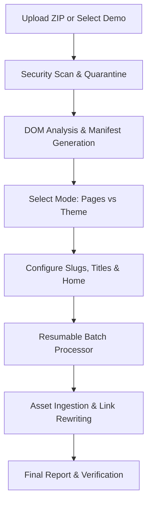

# WPCalibrate HTML Bridge

> **Safely import static HTML websites into WordPress Pages or convert them into standalone WordPress themes.**

---

## 📖 About

**WPCalibrate HTML Bridge** (`wpcalibrate-html-bridge`) is an enterprise-grade migration solution that empowers WordPress administrators, agencies, and developers to upload static HTML/CSS/JavaScript websites and transform them seamlessly into native WordPress content or standalone classic WordPress themes.

Designed with strict zero-execution security, atomic distributed locking, and deterministic URL and asset rewriters, WPCalibrate HTML Bridge bridges the gap between modern static frontend builds and the WordPress ecosystem without risking server safety or visual degradation.

---

## ✨ Features

### 🔄 Dual Primary Import Modes
- **Import as WordPress Pages**: Transforms HTML files into native hierarchical WordPress Pages.
- **Convert to Standalone WordPress Theme**: Generates an independent, fully structured classic WordPress theme (`style.css`, `header.php`, `footer.php`, `page.php`, `index.php`, assets) from your static site design. Never activates themes automatically.

### 🎨 Dual Content Conversion Modes
- **Preserve Design Mode**:
  - Encapsulates markup in an isolated container wrapper (`.wpcalibrate-preserve-design-wrapper`).
  - Reads and inlines local linked stylesheets directly into postmeta (`_wpcalibrate_html_bridge_custom_css`).
  - Employs a direct `wp_head` fallback injector to guarantee styling across classic, block, and hybrid themes.
  - Automatically scopes CSS/JS enqueues strictly to imported pages, never polluting admin or unrelated frontend pages.
- **Native Gutenberg Block Conversion**:
  - Semantically maps standard HTML tags into editable WordPress core blocks (`<!-- wp:heading -->`, `<!-- wp:paragraph -->`, `<!-- wp:list -->`, `<!-- wp:quote -->`, `<!-- wp:table -->`, `<!-- wp:image -->`, `<!-- wp:code -->`, `<!-- wp:separator -->`).
  - Preserves complex, nested, or script-dependent markup safely inside native `<!-- wp:html -->` Custom HTML blocks.
  - Retains imported stylesheet definitions in postmeta so Gutenberg blocks retain their custom styling.

### 🛡️ Multi-Tier Security Architecture
- **Pre-Extraction ZIP Analysis**: Detects ZIP bombs, invalid compression ratios, null bytes, and path traversal (`../`) attempts before reading archive contents.
- **Quarantine Engine**: Automatically neutralizes and quarantines dangerous server-side executables (`.php`, `.phtml`, `.cgi`, `.pl`, `.py`, `.sh`, `.bash`, `.exe`, `.htaccess`, `web.config`).
- **Sandboxed Storage**: Operates strictly within isolated uploads directories protected by automated directory locking.
- **Heartbeat Distributed Locks**: Prevents concurrent migration collisions and execution timeouts with atomic transients.

### 🖼️ Asset Migration & Media Library Integration
- Automatically imports local images and assets into the WordPress Media Library with SHA-256 deduplication and alt text preservation.
- Deterministic rewriting for `src`, `srcset`, `<picture>`, and CSS `url(...)` declarations.

### 🔗 Deterministic Internal Link Rewriting
- Maps relative and absolute static links (`about.html`, `contact/`, `/pricing`) to newly generated WordPress permalinks with anchor fragment (`#id`) and query string preservation.

### 🧭 Semantic Navigation Detection
- Automatically discovers `<nav>` candidates and builds native WordPress navigation menus registered to active theme locations.

### 🧪 Pre-Packaged Modern Demo Templates & Live Interactive Preview
- Bundles 4 production-quality, responsive static websites:
  1. **NexaTech AI Cloud Platform** (`saas-showcase`): High-impact dark SaaS product site with animated gradient hero, real-time SLA metrics ticker, 6 cloud feature pillars, 3-tier pricing matrix, and interactive FAQ accordion.
  2. **StudioVibe Digital Experience Studio** (`agency-portfolio`): Clean editorial studio layout with bold typography, 4 showcase case study cards with performance metrics, 120+ product impact stats bar, 4-column capabilities, and interactive consultation form.
  3. **ApexConsult Enterprise Advisory** (`business-landing`): Executive enterprise advisory website featuring trust badges, $3.8B+ transaction spotlight card, 4 core practice areas, 4-stage advisory lifecycle roadmap, and consultation booking form.
  4. **Lumina Journal Tech & Culture** (`minimal-blog`): Refined editorial magazine layout highlighting semantic HTML5 architecture: lead headline, styled blockquotes, benchmark comparison data table, code snippet styling, callout box, and author bio.
- Fullscreen **Interactive Live Preview Modal** with sandboxed iframe, responsive multi-device switcher (Desktop, Tablet with bezel chassis, Mobile with phone chassis), and direct "One-Click Import" or "Download Static Package" actions.

---

## 🚀 Installation & Dashboard Updates

### Standard WordPress Installation
1. Download the latest `wpcalibrate-html-bridge-1.0.2.zip` from [GitHub Releases](https://github.com/zeeshanraza-official/wpcalibrate-html-bridge/releases).
2. In your WordPress admin dashboard, navigate to **Plugins > Add New > Upload Plugin**.
3. Choose the ZIP file and click **Install Now**, then **Activate Plugin**.
4. Navigate to **WPCalibrate > HTML Bridge** in the WordPress admin menu.

### Automatic Updates from WordPress Dashboard
This plugin includes standard GitHub update headers:
- `GitHub Plugin URI: https://github.com/zeeshanraza-official/wpcalibrate-html-bridge`
- `Primary Branch: main`

You can use popular WordPress dashboard updaters such as **Git Updater** or **GitHub Updater** to receive automatic update notices and one-click upgrades directly within your WordPress plugins screen whenever a new release is published.

---

## 📋 Requirements
- **WordPress**: 6.5 or higher (tested up to 6.7+).
- **PHP**: 8.2 or 8.3 with extensions: `zip`, `gd`, `libxml`, `mbstring`.
- **Runtime Dependencies**: Zero external Composer or npm dependencies. Built 100% on native WordPress and PHP APIs.

---

## 🛠️ Usage Workflow

1. **Upload or Select Demo**: Go to **WPCalibrate > HTML Bridge > New Import** or choose a template from the **Demo Templates** catalog.
2. **Scan & Analysis**: The scanner validates file safety, lists pages, forms, and assets, and displays integration notes.
3. **Configure Options**:
   - Choose **Import Mode**: WordPress Pages or Standalone Theme.
   - For Pages, choose **Preserve Design** (pixel-faithful layout) or **Gutenberg Conversion** (editable native blocks).
   - Set page titles, slugs, and homepage designation.
4. **Execute Import**: The chunked batch engine imports pages, downloads and maps assets, inlines local stylesheets, and rewrites internal hyperlinks.
5. **Review**: Access your created pages or generated themes directly from the completion screen with full rollback capability.

---

## 📝 Changelog

### [1.0.2] - 2026-10-14
- **Fix**: Direct local stylesheet inlining into postmeta (`_wpcalibrate_html_bridge_custom_css`) for both Preserve Design and Gutenberg modes to guarantee CSS rendering across all classic, block, and hybrid themes.
- **Fix**: Added direct `wp_head` styling fallback injection (`printPreservedCustomCss`) in `PreserveDesignRenderer`.
- **Fix**: Ergonomic 2-tier card action layout (`Live Preview` + `One-Click Import` on top, full-width `Download ZIP` on bottom) and balanced 2x2 grid in Demo Templates catalog.
- **Fix**: Rephrased static form detection into a positive "Form Integration Advisory" with clear guidance for form plugins (Contact Form 7, WPForms, etc.).
- **Tweak**: Added `GitHub Plugin URI` and `Primary Branch` headers for WordPress dashboard update management.

### [1.0.1] - 2026-10-14
- **Fix**: Added dynamic `filemtime` cache-busting to administrative CSS and JS assets.
- **Fix**: Strict modal visibility rules in `admin.css` and dark background fallback for browser mockup headers.
- **Enhancement**: Added dedicated "Open in Tab" button to the interactive live preview modal.
- **Enhancement**: Expanded iframe sandbox flags (`allow-forms allow-popups`) for full interactive testing.

### [1.0.0] - 2026-10-14
- Initial production release.
- Pages Import Mode (Preserve Design and Gutenberg block conversion).
- Standalone Classic WordPress Theme Generator.
- Multi-tier ZIP validator and isolated sandbox extraction engine.
- Media Library asset importer, SHA-256 deduplication, and link rewriter.
- Resumable batch processor with heartbeat distributed locking.
- Overview dashboard tab and 4 pre-packaged interactive demo website templates.

---

## 🔒 Security & Support
- **Security**: To report security issues or vulnerabilities, please contact `support@wpcalibrate.com`.
- **Issues & Contributions**: File bug reports and feature requests via [GitHub Issues](https://github.com/zeeshanraza-official/wpcalibrate-html-bridge/issues).
- **Author**: [WPCalibrate](https://wpcalibrate.com/) (`support@wpcalibrate.com`).

---

## 📄 License
Licensed under the GNU General Public License v2.0 or later ([GPL-2.0-or-later](LICENSE)).
